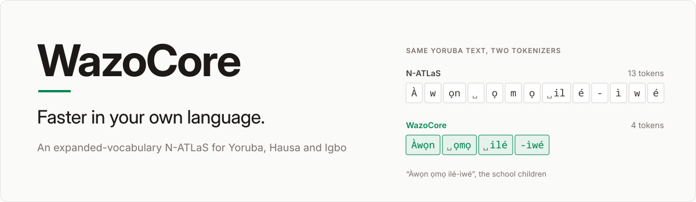
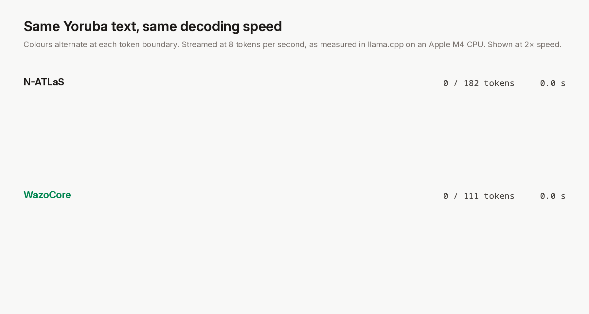

<sub>The same FLORES-200 passage in Yoruba, Hausa and Igbo. Replay of real tokenisations, streamed at the decode speed measured in llama.cpp on an Apple M4 CPU (8 tokens per second), shown at 2× speed. Text colour alternates at each token boundary.</sub>

WazoCore is an 8B language model for Yoruba, Hausa and Igbo, adapted from N-ATLaS, Nigeria's open language model. It extends the base vocabulary with 15,000 tokens for the three languages, reducing token counts by roughly a third and accelerating generation 1.6 to 1.7 times on commodity hardware. It ships as a standard GGUF compatible with llama.cpp, LM Studio and any OpenAI-compatible stack.

**Latest release: v13.** Mathematical reasoning matches the base model, and translation quality is maintained or improved in all three languages. [Release notes](https://github.com/Quantile-Labs/wazocore/releases/tag/v13) · [Model](https://huggingface.co/quantile-labs/WazoCore-8B)

**Developed by** [Quantile Labs](https://quantilelabs.com/).

- **Faster generation**: the same response takes 58 to 62% of the time, because each token carries more of a word. Per-token decoding throughput is unchanged; the gain comes entirely from shorter sequences.
- **Lower serving cost**: a response requires a third fewer tokens. A 5,000-word health leaflet in Yoruba falls from about 14,350 tokens to 9,550.
- **Longer effective context**: the 8,092-token window holds 8.8 pages of Yoruba instead of 5.6.
- **Drop-in compatibility**: same file format, chat template and API. All 128,256 original tokens keep their ids and exact embeddings.

## Results

| WazoCore v13 vs base model | Yoruba | Hausa | Igbo |
|---|---|---|---|
| Tokens per word | 2.87 → 1.91 | 2.12 → 1.34 | 2.53 → 1.56 |
| Generation speed-up (words/s), laptop CPU | 1.63× | 1.61× | 1.72× |
| ΔchrF++, English → X, Q4_K_M | +3.1 (+2.0, +4.1) | −0.4 (−1.2, +0.4) | +0.3 (−1.3, +1.7) |
| ΔchrF++, English → X, held-out | +2.2 (+1.6, +2.8) | −0.4 (−0.9, 0.0) | +0.1 (−0.5, +0.7) |
| ΔchrF++, X → English, held-out | +0.2 (−0.4, +0.7) | −0.1 (−0.5, +0.4) | +0.9 (+0.5, +1.4) |
| AfriMGSM accuracy (WazoCore / base) | 37.2 / 33.6 | 40.4 / 38.8 | 26.0 / 28.0 |
| AfriXNLI accuracy (WazoCore / base) | 52.7 / 57.7 | 53.0 / 57.5 | 52.5 / 58.8 |

Speed is a paired, interleaved benchmark in llama.cpp (Q4_K_M, Apple M4 CPU, 20 prompts per language), measured with the v6 release, which shares v13's tokenizer and token efficiency. Translation is chrF++ against human references with 95% paired-bootstrap intervals, on 250 NTREX-128 sentences for the quantised file and on 1,497 held-out sentences per language at full precision. Reasoning is IrokoBench, zero-shot, at full precision. No test sentence is trained on.

## Method

1. **Vocabulary extension.** 15,000 byte-level BPE merges learned jointly on Yoruba, Hausa and Igbo are appended to the base tokenizer; merges that would split a UTF-8 character are excluded, and input is normalised to NFC.
2. **Initialisation.** New input embeddings start as the norm-matched mean of their constituent pieces, output embeddings as the length-weighted mean.
3. **Partial fine-tuning.** Only the new rows and four of 32 transformer layers are updated, with a KL anchor to the frozen base model and a gradient mask that keeps every original row exact. About 80 minutes on one A100.
4. **Self-distillation.** Alongside the base model's own translations and professional translations, training includes the base model's verified solutions to GSM8K problems in all four languages, which restores mathematical reasoning to base-model level.

The protocol, every table and the command behind each number are in [docs/METHOD.md](docs/METHOD.md); section 4.6 covers v13.

## Get started

Download the GGUF from [Hugging Face](https://huggingface.co/quantile-labs/WazoCore-8B) and serve it with llama.cpp (or load it in LM Studio and start its server):

```sh
hf download quantile-labs/WazoCore-8B WazoCore-8B.Q4_K_M.gguf --local-dir .
llama-server -m WazoCore-8B.Q4_K_M.gguf -c 4096 --port 8080
```

Call it with any OpenAI client:

```python
from openai import OpenAI

client = OpenAI(base_url="http://localhost:8080/v1", api_key="local")
reply = client.chat.completions.create(
    model="wazocore",
    messages=[{"role": "user", "content": "Translate into Hausa: The clinic opens at eight in the morning."}],
)
print(reply.choices[0].message.content)
# Asibitin yana bude daga karfe takwas na safe.
```

It runs offline on a laptop with 8 GB of memory or more.

## Guides

- [Method and results](docs/METHOD.md): the release recipe, the evaluation protocol, every result, the known limitations and the limits of the evidence.
- [Training on a cloud GPU](docs/cloud-vx.md): the pipelines, the upload, run times, outputs and known pitfalls.
- [Model card](release/MODEL_CARD.md): intended use, results, limitations and licence terms.
- [Contributing](CONTRIBUTING.md): setup, tests, adding a language and engineering standards.

## Build for your language

The toolkit that produced WazoCore reproduces it end to end, and adapts to a new language by changing two tables and the input text.

| | Use WazoCore | Build your own |
|---|---|---|
| What you get | Yoruba, Hausa and Igbo, ready to serve | An expanded model for your languages or domain |
| What you need | llama.cpp or LM Studio | Python 3.11, uv, access to the base model, one 80 GB GPU |
| Time | Minutes | A laptop for the tokenizer, about 2 GPU hours for training and evaluation |
| Evidence | This repository's results | The same benchmarks, run on your model |

```sh
git clone https://github.com/Quantile-Labs/wazocore.git && cd wazocore
uv run --project wazocore --group ref pytest wazocore/tests
uv run --project wazocore --group ref python -m wazocore.vocab_expand build --out data/models/wazocore-tok
scripts/cloud_vx_upload.sh HOST PORT data/models/wazocore-tok   # then run cloud_vx_v13.sh on the GPU host (docs/METHOD.md, section 7)
scripts/paired_vx.sh LABEL 4 20 0 path/to/model.gguf
```

## Roadmap

- **Full-precision weights** for v13 on Hugging Face.
- **Reasoning**: close the remaining natural-language inference gap to the base model.
- **More languages**: Nigerian Pidgin and Fulfulde next, then other African languages that pay the same token tax.
- **Distribution**: Ollama and the LM Studio catalogue, and a technical report.

## Citation

```bibtex
@misc{quantilelabs2026wazocore,
  title        = {WazoCore: In-Place Vocabulary Expansion for Yoruba, Hausa and Igbo},
  author       = {Adeniyi, Kayode},
  year         = {2026},
  organization = {Quantile Labs},
  howpublished = {\url{https://github.com/Quantile-Labs/wazocore}}
}
```

## Licence and attribution

The code in this repository is released under the [Apache License 2.0](LICENSE). The files under `results/` reproduce human reference translations from FLORES-200 and NTREX-128, both released under [CC BY-SA 4.0](https://creativecommons.org/licenses/by-sa/4.0/); that text keeps its own licence and is outside the Apache licence.

The model weights are a derivative of N-ATLaS and are released under the N-ATLaS Open-Source Research and Innovation License as "WazoCore Powered by Awarri."; see the [model card](release/MODEL_CARD.md). N-ATLaS is an initiative of the Federal Ministry of Communications, Innovation and Digital Economy, and powered by Awarri Technologies.

Thanks to FLORES-200 and NTREX-128; Google's SMOL translations; Wikipedia in Yoruba, Hausa and Igbo; llama.cpp; and published work on vocabulary expansion (arXiv 2607.15232), low-budget adaptation (arXiv 2406.11477) and embedding initialisation (arXiv 2608.03494).
